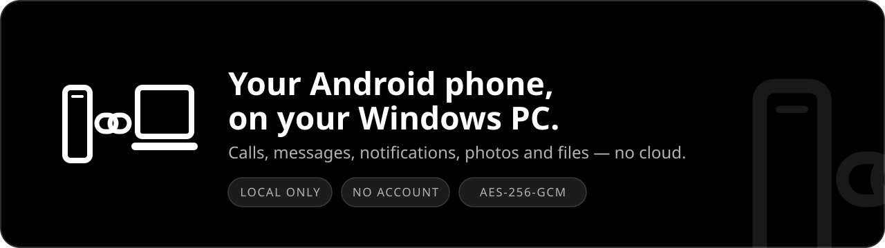
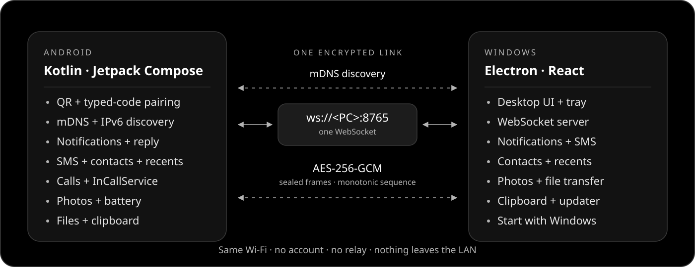

<h1 align="center">LinkPhone</h1>

<p align="center">
  
</p>

<p align="center">
  <a href="https://github.com/FakeAbid11/linkphone/releases/latest"></a>
  <a href="https://github.com/FakeAbid11/linkphone/actions/workflows/ci.yml"></a>
  <a href="LICENSE"></a>
  
  
  
</p>

<p align="center">
  <a href="https://github.com/FakeAbid11/linkphone/releases/latest"><strong>Download the latest release →</strong></a>
</p>

<p align="center">
  <a href="#features">Features</a> ·
  <a href="#architecture">Architecture</a> ·
  <a href="#install">Install</a> ·
  <a href="#security">Security</a> ·
  <a href="#roadmap">Roadmap</a> ·
  <a href="#development">Development</a>
</p>

LinkPhone puts your Android phone on your Windows PC over your own Wi-Fi. Pair once with a QR
code, then handle calls, texts, notifications, photos and files without an account, a cloud
service or a relay server.

**No account. No cloud. No relay.**

> **v0.7.1** adds drag-and-drop file sending; v0.7.0 upgraded the notification center.

## Features

| Feature | Status | Detail |
|---|---|---|
| Pairing and discovery | Yes | QR or 8-character code; mDNS, with an IPv6 link-local fallback |
| Notification mirroring | Yes | Live progress, search, app grouping, per-app mute/clear, actions and reply |
| SMS | Partial | Existing threads only; no MMS or new conversations |
| Dual SIM | Yes | Pick the SMS SIM and call SIM from the PC; labels on messages, calls and history |
| Contacts and call history | Yes | Beside the dialer in Calls: search, call back or open an SMS thread |
| Phone calls | Partial | Dial, answer, decline and hang up; audio stays on the phone |
| Photo albums | Yes | Thumbnails, paged albums, previews and original download |
| Battery | Yes | Live percentage and charging state |
| File transfer | Yes | Both directions, 64 KiB chunks; Send to or drag files onto the window |
| Clipboard | Partial | Text only; phone side only while the app is open |
| Start with Windows | Yes | Opt-in hidden tray start, listed in Windows Startup Apps |
| Auto-reconnect | Yes | 2.5 s backoff across Wi-Fi hiccups |
| Built-in updates | Yes | Automatic checks + notifications; verified Windows/Android installers |
| Screen mirroring | Not yet | Planned; `MediaProjection` + WebRTC |
| App streaming, camera | Not yet | Planned |

## Architecture

<p align="center">
  
</p>

One encrypted WebSocket carries control, messages, calls and 64 KiB file chunks. The phone finds
the PC over mDNS; the QR code also embeds IPv4 and link-local IPv6 addresses for networks that block
discovery. See [docs/PROTOCOL.md](docs/PROTOCOL.md) for the handshake, frames and threat model.

## Install

1. Open the [latest GitHub Release](https://github.com/FakeAbid11/linkphone/releases/latest).
2. **Phone:** install `linkphone-android.apk` (allow “install unknown apps”).
3. **PC:** run `LinkPhone.Setup.0.7.1.exe`. The installer is unsigned, so SmartScreen requires
   **More info → Run anyway**. It also adds **Send to → LinkPhone** to Explorer; Windows 11 may keep
   it under **Show more options**.
4. **Pair:** on the PC, expand **Scan QR code instead** in the sidebar. On the phone, tap **Scan QR**
   and point the camera at the PC.
5. **Grant phone permissions:** notification access for mirroring, SMS for messages, photos for the
   gallery, and contacts + call logs for the contacts hub.
6. **Calls:** tap **Set as default phone app** and accept Android's role prompt.
7. Put both devices on the same Wi-Fi. mDNS and client-to-client traffic must be allowed;
   guest/AP-isolated networks will not work.

<details>
<summary><strong>Upgrading from v0.1 and SmartScreen notes</strong></summary>

v0.1 used a temporary CI signing key. Uninstall it before installing v0.2 or later, then pair again.
From v0.2 onward the permanent key is used, so updates install in place.

The Windows installer and Android APK are unsigned at the platform level: SmartScreen needs
**More info → Run anyway**, and Android always shows its own installer confirmation. Android may
first ask permission for LinkPhone to install updates.

</details>

<details>
<summary><strong>Permissions in detail</strong></summary>

- **Notification access** lets the PC show and reply to phone notifications. It is optional.
- **SMS** reads existing conversations and sends replies; LinkPhone does not become the default SMS
  app and does not create new threads.
- **Photos** uses Android's photo picker permissions; Android 14+ can expose all photos or a
  selected set.
- **Contacts** (`READ_CONTACTS`) resolves names and powers the searchable contact list.
- **Call logs** (`READ_CALL_LOG`) powers recent calls. It is optional and read-only, and Google Play
  restricts it — which is why LinkPhone is distributed as a sideloaded APK.
- **Default phone app** is required for reliable incoming and active call control. Restore your
  previous dialer at any time in Android Settings → Apps → Default apps → Phone app.

All permissions are optional at the OS level; features that need one explain themselves when it is
missing.

</details>

### Feature notes

<details>
<summary><strong>Phone calls stay on the phone</strong></summary>

LinkPhone needs the default-dialer role for dependable call control. The phone includes a minimal
dial/incoming/in-call screen and call notification, so calls remain usable when Windows is offline.

Windows can dial, show incoming calls, answer, decline, hang up and toggle the **phone's** speaker.
Microphone and call audio never cross the network. Do not depend on LinkPhone for emergency
calling; use the phone's emergency interface directly.

</details>

<details>
<summary><strong>Contacts and call history</strong></summary>

Open **Calls** to search the phone book and call or message any number; the contact list sits beside
the dialer. **Recent calls** below it shows direction, time and duration, with a call-back button.
Messaging opens an existing SMS thread only; a number without a thread shows a hint instead. Both
lists are read-only and pulled on demand over the encrypted link.

</details>

<details>
<summary><strong>Dual SIM</strong></summary>

When the phone has more than one SIM, Messages and Calls show a SIM picker. Sending uses the phone
default unless you choose another SIM. The phone needs **Phone access** to list SIMs; without it,
texts and calls keep using the default SIM and labels may be missing. Calls use Android's call
accounts, so eSIM profiles and carrier labels follow what the phone reports.

</details>

<details>
<summary><strong>Send files from Explorer</strong></summary>

Right-click one or more files → **Send to → LinkPhone**, or drag them onto the LinkPhone window. The
app opens the Files tab and sends them. If the phone is not connected, the files wait in memory and
are sent when it connects; quitting LinkPhone discards them. Folders are not supported.

</details>

<details>
<summary><strong>Notification center</strong></summary>

Search notifications by app, title or text, and switch between **Newest** and **By app** views.
By-app headers show a count plus **Clear** and **Mute**: Clear removes that app's current cards,
while Mute also hides future notifications and Windows toasts. Unmute an app from the **Muted**
chips; muted settings persist on this PC. Live progress, quick actions, opening and inline reply
work in both views.

</details>

<details>
<summary><strong>Built-in updates</strong></summary>

v0.4 must be installed manually once because older versions do not contain updater code. After that:

- **Windows:** LinkPhone checks about 20 seconds after launch, every six hours, and after sleep;
  a notification appears when a newer version is available. Choose **Download**, then
  **Restart & install** in Settings.
- **Android:** a background check runs about every six hours even when LinkPhone is closed, and the
  App update card checks when the app opens. A notification appears when a newer version is
  available; choose **Download**, then **Install**. Android always shows its system installer
  confirmation. OEM battery managers may delay the background check; opening the app always checks.
- Neither platform downloads or installs anything without you choosing it.
- Android downloads are verified against GitHub's SHA-256 digest and the certificate that signed
  the installed LinkPhone app before the installer opens.

</details>

<details>
<summary><strong>Theme and Start with Windows</strong></summary>

Both apps use a strictly monochrome, dark-only Material 3 theme: `#000000` background, `#121212`
cards, `#1C1C1C` elevated components, white primary text, `#B3B3B3` secondary text, and white/gray
Material Symbols Rounded icons. There is no light theme and no colorful accent. Android
notifications use a simplified phone + link mark with a gray accent so it stays legible at 24 dp.

**Start with Windows** is off by default in **Settings**. Enabling it registers a per-user login item,
so LinkPhone appears in **Windows Settings → Apps → Startup** and starts hidden in the tray. Disable
it from either LinkPhone or Windows; LinkPhone will not re-enable it.

</details>

### Troubleshooting

<details>
<summary><strong>Discovery finds nothing</strong></summary>

QR pairing embeds every IPv4 address reported by the PC and tries them in private-network order, so
it also works when mDNS is blocked. Client-to-client traffic and TCP port 8765 must still be allowed.
Guest Wi-Fi and AP isolation block device-to-device traffic entirely.

</details>

<details>
<summary><strong>Pairing no longer works after a reinstall or forget</strong></summary>

Since v0.4.8, scanning a fresh QR sends an explicit pairing intent. The PC runs the pairing
handshake even for a phone it already knows and replaces the old key once the new code proves valid.
If a connection still fails, click the **×** on the phone card in the PC sidebar and tap **Forget**
on the phone, then pair again.

</details>

<details>
<summary><strong>Wi-Fi isolates IPv4 clients</strong></summary>

Since v0.4.9 the QR also embeds the PC's link-local IPv6 address, tried after the IPv4 addresses, so
pairing can work without a router change. USB tethering and the phone hotspot remain fallbacks for
networks that block both families.

</details>

<details>
<summary><strong>Notification actions or open do nothing</strong></summary>

The phone's OEM may block background activity starts. On HyperOS, allow LinkPhone to autostart and
to display pop-up windows while running in the background; then retry the action. Inline reply still
works without those permissions.

</details>

## Security

- No account, no cloud, no telemetry. Traffic never leaves the LAN.
- The handshake proves knowledge of the pairing code; every frame is AES-256-GCM with a monotonic
  sequence number and direction-bound AAD.
- SMS, contacts, call history and photo previews use the same encrypted channel and are never
  uploaded. Gallery previews live only in PC memory; originals are saved only when you choose
  **Download original**.
- The PC stores the per-device key in `%APPDATA%\LinkPhone`; the phone stores it in
  `EncryptedSharedPreferences`.
- Updater checks contact only this repository's public GitHub Releases API. They send no phone data,
  account information or telemetry.

> **Not yet hardened:** there is no TLS/pinning, 6-digit pairing codes are accepted, and pairing
> attempts are not rate-limited. A malicious host on your LAN could impersonate the PC. Do not use
> LinkPhone on a network you do not trust.

## Roadmap

1. **MMS and new conversations** — LinkPhone intentionally stays inside existing SMS threads and
   does not claim the default-SMS-app role.
2. **Screen mirroring** — `MediaProjection` → hardware H.264 encoder → WebRTC; touch injection via an
   `AccessibilityService`.
3. **TLS + certificate pinning**, manual IP entry, multi-device support.

<details>
<summary><strong>Why iOS is out of scope</strong></summary>

iOS exposes no SMS API, no notification access except ANCS over BLE, no screen capture of other apps
and no call control. An iPhone client could only mirror notifications and make calls over Bluetooth.
Android-first is the only way to reach feature parity.

</details>

## Development

Everything is built and tested by GitHub Actions; there are no local build steps for normal use.

| Path | Contents |
|---|---|
| `desktop/` | Electron + React + TypeScript PC app, WebSocket server, tray |
| `android/` | Kotlin + Jetpack Compose phone app, notification listener, InCallService |
| `docs/PROTOCOL.md` | Wire format, crypto and threat model |
| `docs/TESTING.md` | Manual test checklist |

```bash
cd desktop
npm install          # npm 12 asks before running electron's postinstall script
npm run dev          # Electron + Vite with HMR
```

Android needs Android Studio or the SDK plus JDK 17; run `gradle :app:installDebug` from `android/`.

## License

MIT — see [LICENSE](LICENSE).

<p align="center"><sub>Not affiliated with Microsoft. Built with Kotlin, Electron and an encrypted WebSocket.</sub></p>
